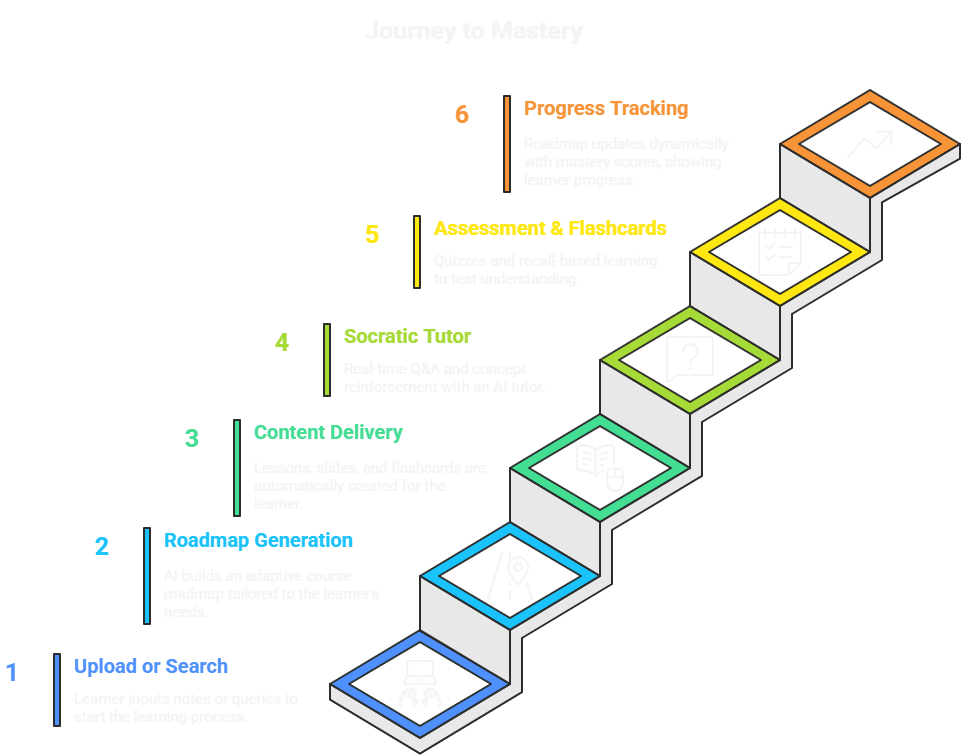

# 🌐 CogniSphere  

<div align="center">

**Your AI-Powered Personal Learning Ecosystem**

[](https://github.com/Amal-Verma/Collaborative-IDE)
[](../LICENSE)
[]()
[]()


</div>

## 📌 Problem: The Fragmented Learning Experience

Self-directed learners today face a broken ecosystem:

- Roadmaps come from one place (forums, blogs).
- Courses from another (Coursera, Udemy).
- Assessments from separate apps.
- Doubt clearing requires costly tutors or expert platforms.

This fragmentation leads to:

- Wasted time searching instead of learning.
- Lack of structure → learners don't progress systematically.
- High costs → quality platforms charge $50–$100 per course or $20–$30/month for tutoring packs.
- Low accessibility → adaptive and personalized tools are rare and often locked behind paywalls.

### 📊 Gravity of the problem:

- **Over 90% of adults engage in informal/self-directed learning**, which makes up **~70% of workplace learning** ([Wikipedia – Informal Learning](https://en.wikipedia.org/wiki/Informal_learning)).  
- The global shift to flexible learning is massive: **Coursera alone has 148M registered learners (as of May 2025)** ([Wikipedia – MOOC](https://en.wikipedia.org/wiki/Massive_open_online_course)).  
- Learners and professionals lose significant productivity due to fragmentation: workers lose **20+ hours per week (~50% of time)** chasing information across disjointed systems ([Quickbase Report](https://www.quickbase.com/about-us/media/report-70-percent-of-workers-lose-20-hours-a-week-to-fragmented-systems), [Clockwise Blog](https://www.getclockwise.com/blog/impact-fragmented-time-productivity)).  
- Translating this into education: **learners waste 30–40% of study time navigating fragmented platforms instead of mastering concepts.**  

**The problem isn’t just inconvenience — it’s a global productivity loss in education.**  

## 👥 Who is Impacted?

| Segment | Challenge Faced |
|---------|-----------------|
| 🎓 **Students** | Struggle to combine notes, courses, and tests |
| 👩‍🏫 **Educators** | Spend hours preparing slides/quizzes |
| 🏢 **Corporate Learners** | Outdated LMS systems lack personalization |
| 🌐 **Independent Learners** | No affordable, guided ecosystem |

👉 A **mass-market problem** spanning individuals, institutions, and corporates.  


## 💡 Our Solution: CogniSphere

CogniSphere integrates roadmaps, lessons, assessments, and tutoring into one adaptive, end-to-end learning ecosystem.

With CogniSphere, learners can:

- 📚 Upload documents (notes, PDFs, PPTs) or search topics.
- 🎞 Get AI-generated courses & slides instantly.
- 📑 Practice with flashcard assessments & quizzes for recall.
- 🤖 Use a 3D AI tutor for doubts and deeper exploration.
- 📊 Follow dynamic learning roadmaps with real-time performance analytics.

**CogniSphere** = Affordable, accessible and scalable learning without dependence on costly experts.

## ✨ Key Features  

| Feature | Description | Status |
|---------|-------------|--------|
| 🔒 **Personal Library** | All learning materials intelligently structured | ✅ Active |
| 🎞 **AI Presentations** | Docs → Slides + Speaker Notes | ✅ Active |
| 📑 **Flashcards** | Recall-based assessment & reinforcement | ✅ Active |
| 🤖 **3D Tutor** | Context-aware interactive Q&A | ✅ Active |
| 📝 **Dynamic Quizzes** | Auto-generated with remedial lessons | ✅ Active |
| 📊 **Adaptive Roadmaps** | Personalized, real-time progress | ✅ Active |
| 📱 **Cross-Platform** | Web + Mobile app | ✅ Active |

## 🛠️ Tech Stack & Architecture

```
┌═══════════════════════════════════════════════════════════════════════════════════════┐
║ 🎨 FRONTEND LAYER ║                                                                   ║
╠═══════════════════════════════════════════════════════════════════════════════════════╣
║ ║                                                                                     ║
║ 🌐 Next.js (Web App) 📱 React Native (Mobile App) ║                                  ║
║ ├─ Dashboard & Analytics ├─ Flashcards, Tutor Access ║                                ║
║ ├─ Roadmap Visualization ├─ Interactive Lessons ║                                     ║
║ └─ Cross-Platform UI └─ Mobile-First Adoption ║                                       ║
║ ║                                                                                     ║
╚═══════════════════════════════════════════════════════════════════════════════════════╝
│
▼
┌═══════════════════════════════════════════════════════════════════════════════════════┐
║ ⚙️ BACKEND & STORAGE ║                                                                ║
╠═══════════════════════════════════════════════════════════════════════════════════════╣
║ ║                                                                                     ║
║ ⚙️ Next.js API Routes 🗄 Supabase PostgreSQL ║                                        ║
║ ├─ Authentication ├─ User Profiles & Course Data ║                                    ║
║ ├─ CRUD APIs ├─ Performance Tracking ║                                                ║
║ └─ Orchestration └─ ACID Transactions ║                                               ║
║ ║                                                                                     ║
║ 📂 Supabase Storage ☁️ Cloud-Native Infra ║                                          ║
║ ├─ Notes, PDFs, PPTs ├─ Scalable Deployment ║                                         ║
║ └─ Media Assets └─ CDN for Fast Access ║                                              ║
║ ║                                                                                     ║
╚═══════════════════════════════════════════════════════════════════════════════════════╝
│
▼
┌═══════════════════════════════════════════════════════════════════════════════════════┐
║ 🤖 AI / ML LAYER ║                                                                    ║
╠═══════════════════════════════════════════════════════════════════════════════════════╣
║ ║                                                                                     ║
║ 🚀 FastAPI RAG Server 🔎 ChromaDB ║                                                  ║
║ ├─ Document Ingestion ├─ Embeddings + Semantic Search ║                               ║
║ ├─ Contextual Retrieval └─ Efficient Query Pipelines ║                                ║
║ ║                                                                                     ║
║ ✨ Gemini 2.0 Flash LLM 🧠 Adaptive AI ║                                             ║
║ ├─ Course & Slide Generation ├─ Roadmap Adaptation ║                                  ║
║ ├─ Socratic Tutor Conversations └─ Personalized Recommendations ║                     ║
║ ║                                                                                     ║
╚═══════════════════════════════════════════════════════════════════════════════════════╝
```

### 🔄 Integration Flow

Frontend (Next.js + React Native) ↔ Backend (Next.js APIs + Supabase) ↔ AI Layer (FastAPI + ChromaDB + Gemini 2.0)

### ⚡ Performance Optimizations

- Caching & batching Gemini API calls
- CDN for static assets & media
- Database indexing & query optimization
- Horizontal scaling via cloud infra

## 🔄 Flow of the App

1. 📥 **Upload or Search** → Learner inputs notes or queries.
2. 📚 **Roadmap Generation** → AI builds adaptive course roadmap.
3. 🎞 **Content Delivery** → Lessons, slides, flashcards auto-created.
4. 🧑‍🏫 **Socratic Tutor** → Real-time Q&A and concept reinforcement.
5. 📝 **Assessment & Flashcards** → Quizzes, recall-based learning, remedial lessons.
6. 📊 **Progress Tracking** → Roadmap updates dynamically with mastery scores.



## 🚀 Quick Start

### 📋 Prerequisites
- **Node.js** v18+ and npm/yarn
- **Python** 3.11+ and pip
- **Supabase account** (for DB + storage)
- **ChromaDB** (local or managed instance)
- **Gemini 2.0 API key** (for AI generation)

### ⚡ 1-Minute Local Setup

```bash
# Clone the repository
git clone https://github.com/your-username/cognisphere.git
cd cognisphere

# Frontend (Next.js)
cd frontend && npm install && npm run dev

# Backend (FastAPI)
cd backend && pip install -r requirements.txt && uvicorn main:app --reload
```
Access the application at `http://localhost:3000` 🎉

## 💹 Scalability & Business Model

### 📈 Scalability

- Cloud-native, modular architecture → scalable to millions.
- Optimized Gemini API usage → caching, batching, and credits minimize costs.
- Cross-platform design → mobile-first adoption for wider reach.

### 💰 Business Model

- **Freemium** – Entry point with limited roadmap/course generation.
- **Pro Subscription** – Unlimited courses, uploads, flashcards, analytics.
- **Institutional Licensing (B2B)** – Bulk licensing for schools & corporates with admin dashboards.
- **Pay-As-You-Go Credits** – Additional AI credits for power learners.

This model drives mass adoption while ensuring sustainable revenue.

## 🌍 Impact & Market

- **Accessibility**: Learners everywhere can study independently without tutors.
- **Affordability**: Eliminates high costs of fragmented platforms.
- **Scalability**: Works for individuals → institutions → corporates.

### 📊 Market Opportunity:

- **Global EdTech market** is projected to grow from **~USD 250B in 2024 to USD 721B by 2033 (CAGR ~11.9%)** ([EinPresswire](https://www.einpresswire.com/article/820371237/edtech-market-report-2025-2033-global-growth-trends-key-segments-and-leading-players), [OpenPR](https://www.openpr.com/news/4048837/edtech-market-report-2025-2033-global-growth-trends-key)).  
- The **personalized learning market** is expanding rapidly: **USD 4.74B in 2024 → USD 5.96B in 2025 → USD 14.15B by 2029 (CAGR ~25.7%)** ([The Business Research Company](https://www.thebusinessresearchcompany.com/report/personalized-learning-global-market-report)).  
- Another forecast pegs **personalized learning at USD 6.99B in 2024 → USD 33.1B by 2033 (CAGR ~18.9%)** ([Market Reports World](https://www.marketreportsworld.com/market-reports/personalized-learning-market-14713530)).  
- **CogniSphere targets the fastest-growing sub-sectors**: self-learning and corporate upskilling.  

## 🎥 Demo

- 📺 [Demo Video](https://drive.google.com/file/d/1RRpRLzMXCOpfMH36hEid-LavhpQJ9yl7/view?usp=sharing)
- 🌐 [Live Prototype](https://launchpad-mappa.vercel.app/)

## 🔑 Why CogniSphere is Product-Ready

- **Huge Problem, Globally Relevant** → fragmented learning, high costs, inefficiency.
- **Clear Solution** → end-to-end ecosystem integrating roadmaps, lessons, assessments, tutoring.
- **Business Model & Market Fit** → freemium → subscription → B2B licensing.
- **Scalability** → cloud-native, cost-optimized, mobile-first.

CogniSphere delivers the power of a complete learning infrastructure in one accessible, adaptive, and affordable platform.

## 🔮 Future Roadmap

- 🌐 Multilingual support for global learners.
- 🎓 Institutional dashboards for large-scale adoption.

## 🧩 Challenges & Learnings

- Controlling API costs while scaling Gemini usage.
- Designing UI/UX that is intuitive yet powerful.
- Learned how to transform a fragmented market into a unified product ecosystem.

## 🤖 AI Assistants in the Build Process

CogniSphere was built leveraging cutting-edge AI assistants that accelerated ideation, coding and content generation:

- ✍️ **GitHub Copilot** – Code autocompletion and boilerplate generation.  
- 💬 **ChatGPT** – Brainstorming, debugging, and refining documentation.  
- 🔮 **Gemini Pro (College Students)** – For roadmap generation, tutoring, and adaptive learning content.  
- ⚡ **Bolt.new** – Rapid prototyping of frontend components.  
- 🧾 **Claude** – Structuring reports, ensuring clarity, and polishing user-facing copy.  

These AI assistants were not just supplementary — they helped us build faster, smarter and with a product-first mindset.

## 🙌 Acknowledgements

- GDG VIT MUMBAI
- Mentors & Organisers of LaunchPad, VIT MUMBAI
